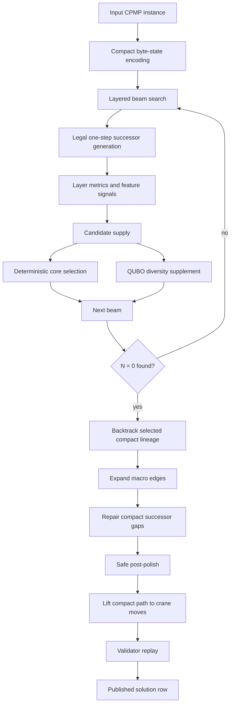
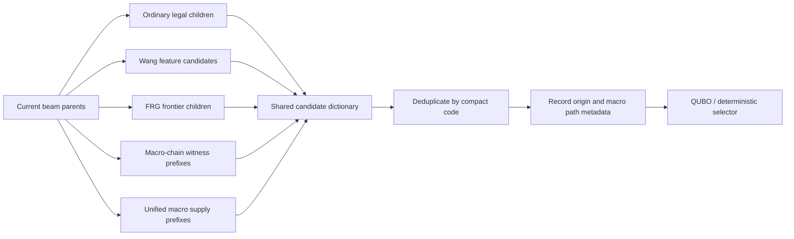
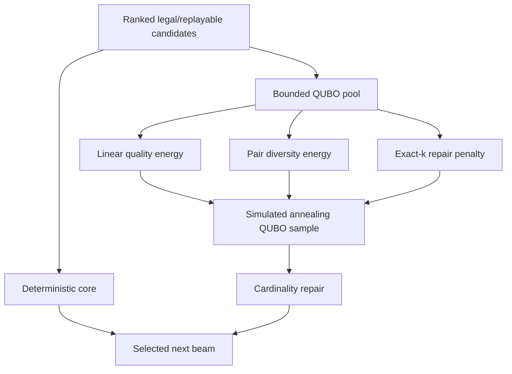
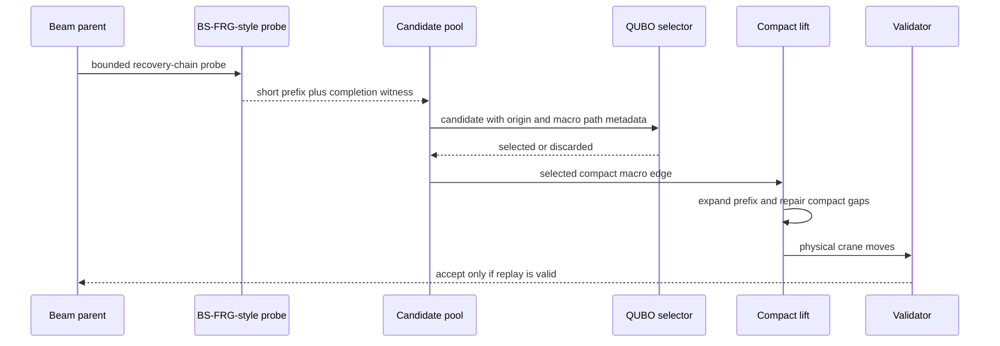
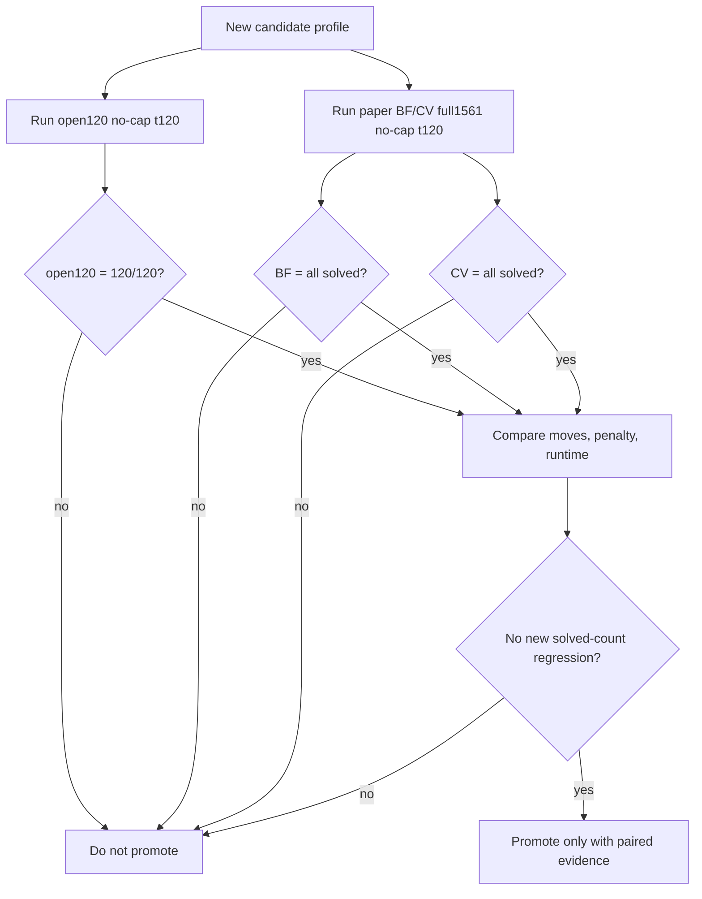

# v4.0 Flow Diagrams

> [!IMPORTANT]
> Historical v4.0 baseline. The promoted mainline is [v4.3](../../guides/v43-mainline-algorithm.md), validated at `1681/1681` with `105530` moves.

Date: 2026-07-03

These diagrams describe the current promoted profile:

```text
qubo_scheduler_state_v5_qubo_diversity_union_unified_macro_supply_chainaware_polish
```

## End-To-End Pipeline



## Candidate Supply Layer



## QUBO Selector



Linear quality energy favors low `N`, low depth, Wang fixed-prefix/pair quality,
FRG transition quality, completion witness quality, receiver-debt control,
source-scarcity relief, and macro path evidence.

Pair diversity energy penalizes same-parent crowding, same-source crowding,
similar reduce signatures, same `N` band, repeated macro origin, and repeated
macro ancestry.

## Macro Candidate Lifecycle



## Promotion Gate



## What The Diagram Intentionally Excludes

There is no final "run BS-FRG fallback" branch and no "accept QUBO move" branch.
That is deliberate. v4.0 keeps a single solver path: compact beam search plus
QUBO survivor selection plus validator replay.
