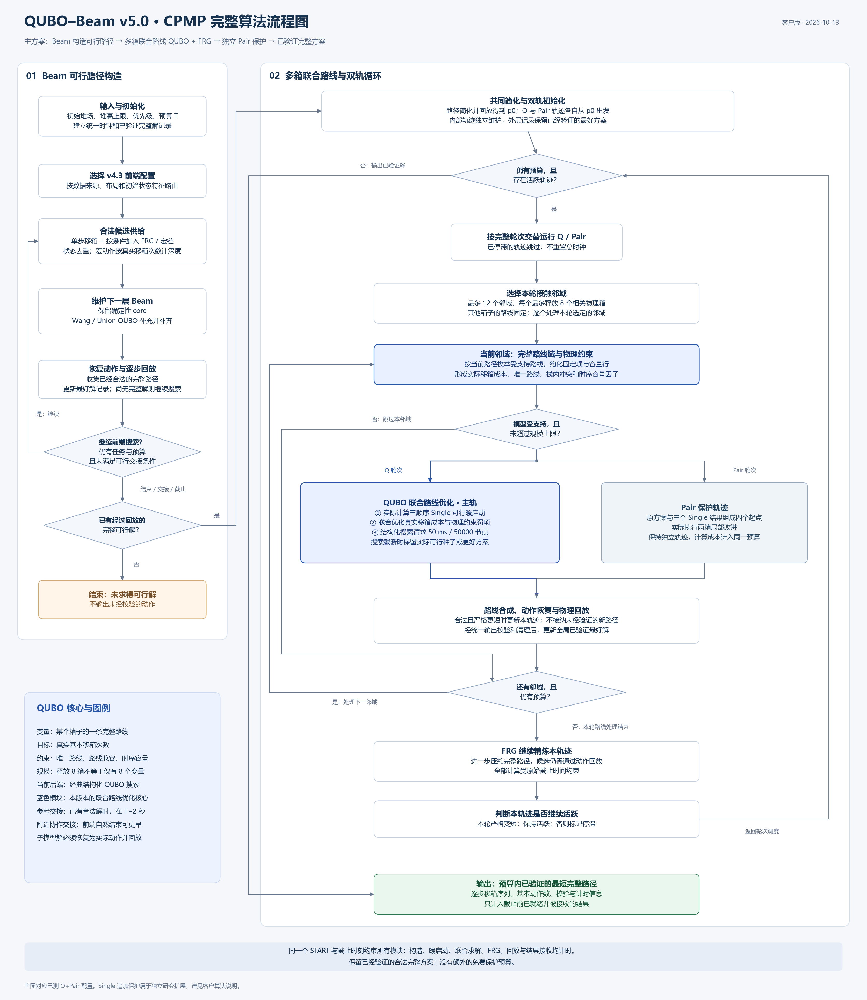

# QUBO–Beam v5.0 集装箱预翻箱优化算法

**客户技术说明｜2026 年 10 月 13 日**  
主说明配置：多箱联合路线 QUBO + Beam 可行解构造 + FRG 循环精炼 + 独立 Pair 保护。  
文档性质：算法方案与研究验证说明，不作为生产发布验收记录。

## 1. 方案概述

QUBO–Beam v5.0 面向集装箱预翻箱问题（CPMP）：在堆高、栈顶取放和箱序优先级约束下，生成合法的堆场调整方案，并尽量减少基本移箱次数。

**v5.0 的核心是将多个箱子的整条移动路线作为联合决策对象，由 QUBO 同时选择一组相互兼容、总移箱次数更少的路线。** Beam 提供完整可行起点，QUBO 对多箱路线进行联动优化，FRG 继续压缩路径，独立经典轨迹为部分局部停滞提供补充。

这一设计把 QUBO 的作用推进到了完整作业方案的优化：每个选中变量对应一条可恢复的箱子路线，优化目标直接对应真实移箱次数，输出必须通过逐步物理回放。

已完成的 hardset169 研究比较中，主方案相对 v4.3 在双方两次均成功的 150 个原始算例上，平均移箱数由 **201.68 降至 169.63，减少 15.89%**。这是完整流程的收益；新增 QUBO 模块的独立增量通过匹配经典对照另行验证，见第 6 节。

## 2. 输入、输出与优化目标

| 项目 | 内容 |
|---|---|
| 输入 | 各堆栈的初始箱序、堆高上限、箱子优先级规则、总求解预算 |
| 合法动作 | 从源栈栈顶取出一个箱子，放入另一个未满栈 |
| 目标状态 | 各栈满足给定优先级顺序 |
| 优化目标 | 尽量减少达到目标状态所需的基本移箱次数 |
| 输出 | 完整移箱序列、基本动作数、可行性校验与计时信息；终态可由序列回放得到 |

本文评价的是移箱次数。实际作业时间、能耗、行走距离和多设备并行收益，需要结合现场设备及业务规则进一步验证，不能直接等同于移箱次数的改善比例。

## 3. QUBO 的核心作用

### 3.1 同时优化多箱整条路线

堆场中的箱子相互制约：一个箱子的暂存位置会影响另一个箱子的取放，多个箱子还可能在同一时刻争用有限堆位。因此，某条路线单独缩短时可能不合法，但若同时改变另外几条路线，整体就能变得合法且更短。

v5.0 对当前完整路径提取物理接触关系，每个邻域最多释放 8 个相关箱子，其他箱子的路线保持固定。对释放箱子枚举受支持的完整路线，允许跳过原有动作、绕过不必要的中转，并允许至多一次保留动作改变目标栈。路线仍遵守输入方案的跨箱事件先后顺序。

QUBO 在这些路线之间联合选择，处理三类真实物理关系：

- **唯一路线：**每个释放箱子恰好选择一条完整路线。
- **路线兼容：**避免违反栈顶可达性的驻留冲突，并满足终态优先级顺序。
- **时序容量：**在相关事件时刻，所有选中路线的共同占用不超过堆栈容量。

二次项表达路线之间的制约；协同收益来自同时满足约束的路线组合，以及该组合更低的实际移箱成本。

### 3.2 与前端 QUBO 选集的分工

| QUBO 所在位置 | 决策对象 | 作用 |
|---|---|---|
| 继承的 Beam 选集机制 | 已生成的候选状态 | 在确定性核心之外补充质量与多样性候选，辅助前端搜索 |
| **v5.0 新联合路线模块** | **多个物理箱的完整候选路线** | **直接减少完整方案的实际移箱次数，是本版本的核心研究贡献** |

前端继续使用 Wang 质量信息、FRG 宏链供给和 Union 候选选择。新路线 QUBO 的目标系数来自真实动作成本及物理约束，Wang 主要通过前端产生的路径间接影响新模型。

### 3.3 已观察到的联合必要性

在实际 CPMP 路径的局部验证中，已记录以下机制见证：

| 验证实例 | 局部改进 | 物理回放与组合检查 |
|---|---|---|
| CV10-6 算例 2 | 完成 Pair 局部改进后的 183 步降至 182 步 | 穷举该次记录的 3 条替换路线的全部 8 个子集，必须同时替换 3 条才有严格可行改善 |
| CV10-6 算例 8 | 完成 Pair 局部改进后的 241 步降至 239 步 | 对记录的 6 条路线替换穷举 64 个子集，至少同时改变其中 4 条才有严格可行改善 |

这些结果支持“多箱联合决策能发现局部单箱、两箱修改无法单独实现的组合改进”。它们是受限邻域的机制证据，不是原始 CPMP 的全局最优证明。

## 4. 完整算法流程

附图对应本文的 **Q+Pair 主方案**。同时提供可缩放的 SVG 与可编辑的 Mermaid 源码。

**步骤 1：初始化。** 读取堆场与优先级规则，建立统一开始时刻和截止时间，初始化已验证完整解记录。

**步骤 2：Beam 构造可行路径。** 按输入来源、布局和初始状态特征选择既有前端配置。每层生成合法单步移箱，并按条件加入 FRG 子状态、宏链前缀和统一宏候选；去除重复状态，宏路径按实际基本移箱次数计费。保留确定性 core，再由 Wang/Union 等机制补充并补齐下一层 Beam。完整候选经动作恢复和回放后进入解记录。

**步骤 3：交接与共同简化。** 前端自然结束，或在已有合法完整解且达到交接条件时，将方案交给后续精炼。对路径执行共同简化并再次校验，得到起点 p₀。若搜索结束或预算耗尽仍无完整可行解，则返回“未求得可行解”。

**步骤 4：初始化两条独立轨迹。** Q 主轨和 Pair 保护轨迹均从 p₀ 出发，各自维护自己的完整路径。按完整轮次交替运行活跃轨迹；停滞轨迹跳过。两条轨迹共享一个总预算。

**步骤 5：执行一轮路线精炼。** 从当前轨迹选择最多 12 个接触邻域，每个最多释放 8 个箱子。逐个邻域按当前路径构造路线域及物理约束，约化固定项。Q 主轨先实际计算三种顺序的单箱下降暖启动，再执行有界 QUBO 联合搜索；Pair 轨迹实际执行四起点的两箱局部改进。模型超限时跳过该邻域；求解截断时保留已经得到的合法解。

**步骤 6：恢复与校验。** 将选中路线合成为基本移箱序列，核对栈顶取放、容量、箱子守恒及终态顺序。合法且严格更短的方案才能更新本轨迹；经统一输出校验和清理后，可更新全局最好解。

**步骤 7：FRG 继续精炼。** 一轮路线处理后，FRG 尝试进一步缩短当前轨迹。若整轮没有严格改善，标记该轨迹停滞；否则下一轮从新的完整路径重建邻域。内部轨迹与全局输出记录分别维护，使另一条当前较长的轨迹仍可继续探索。

**步骤 8：输出。** 两条轨迹均停滞或预算到期时，返回截止前已就绪并被接收的最短合法完整路径。任何更低的模型能量，都必须先转化并验证为实际动作，才能成为输出。

## 5. 联合路线 QUBO 模型

设当前完整方案长度为 L₀，B 为仍有多个路线选项的物理箱集合，Rᵦ 为箱子 b 的候选完整路线集合。每个路线选项对应一个二进制变量 xᵣ；容量松弛使用二进制变量 z。

\[
\begin{aligned}
\min E(x,z)={}&C+\sum_r m_r x_r\\
&+\lambda\sum_{b\in B}\left(\sum_{r\in R_b}x_r-1\right)^2\\
&+\lambda\sum_{r<s}K_{rs}x_rx_s\\
&+\lambda\sum_{\rho}\left(
\sum_r a_{\rho r}x_r+\sum_k w_{\rho k}z_{\rho k}-h_\rho
\right)^2,
\qquad \lambda=L_0-C+1.
\end{aligned}
\]

| 符号 | 含义与作用 |
|---|---|
| xᵣ ∈ {0,1} | 是否选择路线 r；一个变量代表整条路线，不是一个单步移箱动作 |
| mᵣ | 路线 r 的真实基本移箱次数；目标项直接对应作业动作数 |
| C | 未释放箱子及约化为固定选项的路线成本；保留完整路径成本口径 |
| λ | 统一罚系数 L₀−C+1；随当前子问题的已知可行路径确定 |
| Rᵦ | 同一物理箱的路线选项组；平方项要求恰选一条 |
| Kᵣₛ ∈ {0,1} | 两条不同箱路线是否存在栈内可达性或终态顺序冲突 |
| aρᵣ ∈ {0,1} | 路线 r 是否占用某个“堆栈—事件时刻”的容量行 |
| hρ | 扣除固定及必然占用后的剩余容量 |
| wρₖ、zρₖ | 用有界二进制权重表示剩余空位，把容量不等式转为平方罚项 |

由于移箱成本非负、约束违反量为整数，任一违反编码约束的赋值，其能量至少为 C+λ=L₀+1；已知输入方案能量为 L₀。因此，任何不高于 L₀ 的赋值都满足所编码约束。在松弛正确填充并通过动作回放时，可行模型能量等于完整路径的真实移箱数。

**实际数值例子：**某次局部模型输入为 100 步，固定成本 C=91，因此 λ=10。模型包含 4 个活动箱组、22 个路线变量和 6 个容量松弛变量，共 **28 个二进制变量**。实际计算的单箱暖启动为 99 步；QUBO 联合优化给出 98 步。该轮解满足“因子能量 = 显式矩阵能量 = 回放后的实际路径长度 = 98”。

当前实现采用与标准 QUBO 矩阵能量等价的因子表示，减少不必要的矩阵展开。后端是经典、结构化的 QUBO 搜索，使用传播、下界和分支定界；现有性能结果不构成量子硬件加速结论。子模型的局部最优认证也不等于完整 CPMP 的全局最优认证。

## 6. 已验证收益

### 6.1 完整流程比较

hardset169 包含 BF 73、CV 84、Open120 12 个原始算例。全组均被尝试，每例运行两次。路径比较先对每例两次结果取均值，仅在双方两次均成功的原始算例上进行；失败单独计入可行率。

| 比较范围 | 同一单次预算 | 对照 v4.3 平均移箱数 | v5.0 Q+Pair 平均移箱数 | 平均减少 |
|---|---:|---:|---:|---:|
| hardset169 实验，150 个双方共同成功原始算例 |20 秒|201.68|169.63|**15.89%**|
| 扩预算诊断中的原主组 12 例 |120 秒|159.42|128.08|**19.65%**|

20 秒全组中，v4.3 与 Q+Pair 均为 325/338 次可行，但成功样本并不完全一致。后续 27 例扩预算诊断在 60/120 秒下均达到每种方法 54/54 次可行。该诊断集合包含特意选入的长尾，不是新的全 hardset169 长预算确认。

所有比较采用同一预算口径：导入和源文件检查预热后，从统一 START 开始计入实例载入、前端搜索、建模、求解、FRG、校验和传输；不包含解释器冷启动。v4.3 对照同样经过共同输出清理与最终物理校验。结果存在逐例及单次退化，不能据平均优势承诺每次都优于对照。

### 6.2 新 QUBO 模块的独立增量

为区分共同经典精炼与新 QUBO 的贡献，设置相同前端、路线建模规则、暖启动、双轨调度与总预算的 Single+Pair 对照，移除主轨上的联合 QUBO 搜索。

| 全困难集实验 | 共同成功原始算例 | Q+Pair 相对匹配经典控制的胜/负/平 | 平均路径减少比例 |
|---|---:|---:|---:|
| 面板 A，20 秒 |157|83 / 19 / 55|**约 1.08%**|
| 面板 B，20 秒 |156|83 / 17 / 56|**约 0.92%**|

两套实验的原始算例级平均差 95% 区间均小于零；36 个原始算例在两套实验共四次运行中均严格改善，并有匹配的模型、种子和联合路径来源证据。

因此，当前证据支持两层结论：**完整 v5.0 流程具有平均路径优势；联合路线 QUBO 在强经典控制之上提供了可重复的增量。** 两者的收益幅度应分别报告。扩预算诊断中，Q 相对匹配经典保护的增量仍较小，部分比较区间跨零；本说明不据此声称 QUBO 在所有预算或所有后端上都占优。

## 7. 参考运行配置与解的可信性

| 项目 | 当前已测参考设置 |
|---|---|
| 每个联合邻域 | 最多释放 8 个相关物理箱 |
| 每轮路线精炼 | 最多 12 个接触邻域 |
| 路线域 | 保留完整受支持选项；枚举路线数上限 20000 |
| 模型规模 | 约化后不超过 4096 个二进制变量，包含容量松弛位 |
| 单模型 Q 搜索 | 请求上限 50 毫秒或 50000 节点，同时服从剩余总预算 |
| 总预算验证 | hardset169 使用 20 秒；扩预算诊断另测 60、120 秒 |
| 结果接受 | 真实动作回放合法、严格改善、截止前可用 |

“8 个箱子”不等于“8 个变量”：每个箱子可有多条路线，还需要容量松弛变量。50 毫秒是局部联合搜索请求，不包含模型构造和暖启动；这些费用仍计入总预算。

在单次运行中，系统始终保留已经验证的最好方案。某个模型超限、搜索截断或局部尝试没有改善，不会把未经验证的新动作替换到已确认方案中。若预算内没有获得初始完整可行解，则明确返回未求得结果。

## 8. 研究扩展与适用范围

为补充 Q 与 Pair 可能共同错过的路径，已实现 Q→Single→Pair 三轨研究配置。固定前端输入、全部新精炼计时的诊断中，它将两个指定输入分别从 242 降至 194 步、从 255 降至 232 步，并重复验证。这些修复来自实际运行的 Single 保护，**未计入本文 Q+Pair 主方案的成绩**；三轨配置仍有少量退化，尚未完成新的广泛端到端确认。

现有结果支持将 v5.0 用于后续 CPMP 试用与业务集验证。生产部署仍应按客户算例核对可行率、平均与尾部路径质量、耗时、接口和设备约束。当前结论限于所列集合和预算，不包含全 1681 例 v5.0 生产回归或现场运行验收。

本说明依据截至 2026 年 10 月 13 日归档的两套 hardset169 实验、扩预算诊断、联合路线机制验证及逐步物理回放记录编制。逐例结果与动作序列可作为进一步技术核验材料。
