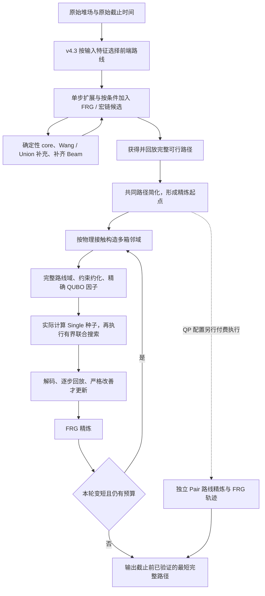

# 上港 CPMP QUBO–Beam v5.0：联合路线模型、完整算法与验证结果

日期：2026-10-13  
版本：v5.0 研究主版本  
验证集合：hardset169（BF 73、CV 84、Open120 12）  
本文全hardset169证据预算：每次运行从原始堆场开始，共用一个 20 秒截止时间

> 发布快照说明：本文描述原始研究实现及证据归档位置。本次源码快照提供完整算法运行入口 `scripts/run_cpmp_v50.py`、必要依赖、公开基准和精简证据；不包含下文提及的全部历史逐次日志。发布范围与实际检查见[发布说明](../releases/v5.0.md)。

> 2026-10-13 扩预算补充：已另行完成27例的20/60/120秒诊断。120秒下原Q+Pair平均175.09步、单轨Q为179.26步、v4.3为245.30步；该集合含选定长尾，不能外推为全169结果。另有独立Single保护修复48/23步的固定输入见证，仍属实验配置。详见[扩预算与长尾修复结果](../experiments/v50_budget_tail_20261013/研究结论_20261013.md)。下文两套全169证据及模型定义保持原口径。

## 1. 版本决定与核心结论

将“v4.3 可行路径生成 + 多箱联合路线 QUBO + 循环 FRG 精炼”命名为 **QUBO–Beam v5.0 研究主版本**。当前证据已经支持这一研究版本命名：新增联合优化模块在困难集上，相对强经典对照有重复、可归因的实际路径收益。

**本次命名不等于生产默认替换。** 仓库现有生产默认仍是 v4.3；本次没有更改旧基准运行器的默认参数。v4.3 的历史全量验证覆盖 1681 例、使用 120 秒预算；v5.0 的最新证据覆盖 hardset169、使用 20 秒预算。两者不能混写为同一项发布验收。也不能用历史长预算的 169/169，否定当前短预算结果，或反过来宣称已复现 169/169。

| 版本/配置 | 实际模式名 | 本文定位 | 已有证据范围 |
|---|---|---|---|
| **v5.0-Q** | `qubo_cycle` | 单轨研究配置；20秒面板 B 观察均值最好，较长预算需同时评估保护 | 与独立 Single、独立 Pair、双轨方法的完整困难集比较；原全169面板尚无该单轨配置直接对 v4.3/BS-FRG 的同面板比较；后续27例诊断补有v4.3对照 |
| **v5.0-QP** | `qubo_pair` | 带独立 Pair 轨迹的双轨配置；完整流程比较证据最齐 | 面板 A 直接比较 v4.3、BS-FRG、Single+Pair、等价 MILP+Pair；面板 B 补齐强单轨对照 |
| **v4.3** | 原有 `...wang_route_v43_polish` | 现有生产默认、可行路径生成前端、历史基线 | Open120 120/120、BF 721/721、CV 840/840；共 1681/1681 |

v5.0-Q/QP 是本文对已有运行模式的版本命名，不是已经新增的 `--variant` 字符串。历史代码中的 `scheduler_state_v5` 是旧调度器名称，也不等同于本文的完整算法 v5.0。

三项主要结果：

1. **完整流程收益：**面板 A 的 150 个共同成功原始算例上，v5.0-QP 相对同为 20 秒预算的 v4.3，平均移箱数由 201.68 降至 169.63，降低 **15.89%**，胜/负/平为 131/9/10。这是整条流程的收益。
2. **新增 QUBO 的净贡献：**相对使用相同双轨调度的 Single+Pair，面板 A/B 分别减少 294/247.5 个“原始算例两次均值之和”的移箱数，约降低 **1.08%/0.92%**；两套实验的原始算例级平均差 95% 区间均小于零。
3. **单轨联合优化本身有效：**面板 B 上，v5.0-Q 相对独立 Pair 减少 660.5 个均值汇总移箱数，降低 **2.43%**，胜/负/平为 81/16/59。这是次要分析，不能替代预先冻结的双轨主比较。

因此，当前最有根据的贡献表述是：**在真实可执行完整路径上，构造多箱相互制约的整条路线邻域，以实际移箱次数建立精确 QUBO 因子模型，并在统一预算内循环联合优化与 FRG 精炼，获得超出强局部经典方法的路径收益。**

## 2. 问题、输出与模块分工

CPMP 输入为堆场初始状态、堆栈容量和箱子优先级。每一步只能把源栈栈顶箱移到另一个未满栈。目标是达到符合优先级顺序的最终堆场，并尽量减少**真实基本移箱次数**。

完整解为动作序列

\[
p=(a_1,\ldots,a_L),\qquad f(p)=L.
\]

每个动作携带箱子、源/目标栈及层位信息。建模时使用物理箱身份区分同优先级的不同箱子；不能把优先级标签直接当作唯一箱号。最终必须逐步回放，核对栈顶可达性、容量、箱子守恒、动作坐标和终态顺序。

| 模块 | 维护或优化的对象 | 在 v5.0 中的作用 |
|---|---|---|
| v4.3 Beam | 中间堆场状态、实际深度、父节点和路径证据 | 从原始堆场构造完整可行路径 |
| Wang 与旧 Union QUBO | Beam 候选状态及局部质量/多样性 | 继续服务于前端搜索；不是此次新增核心 |
| FRG、宏链与统一宏供给 | 可回放的多步路径及中间状态 | 提供前端恢复证据、宏候选；也用于后续完整路径精炼 |
| **新联合路线 QUBO** | 多个物理箱各自的整条候选路线 | 同时决定多箱如何改路，使完整路径更短 |
| 独立 Pair 轨迹 | 从共同初始路径出发的另一条完整路径演化 | v5.0-QP 中付出真实计算时间的补充搜索 |
| 输出账本 | 已实际计算、回放通过的完整解 | 只公布截止时间前可用的严格改善 |

**新 QUBO 没有替换 Beam 的确定性 core，也没有把整个 CPMP 一次性编码成全局 QUBO。** 它作用于已有完整解的受限多箱路线邻域。Wang 通过前端产生的路径间接影响新模型；新模型的目标系数不是 Wang 分数，而是真实移箱次数与物理约束罚项。

## 3. 完整算法流程



### 3.1 初始化与统一预算

固定原始起点 `start`，截止时间为 `start + 20s`。实例载入、前端 Beam、路径清理、路线枚举、种子计算、QUBO 构建和求解、FRG、回放及结果传输都计入这一时钟。实验中的模块导入和源文件检查在 `READY` 之前预热，因此 20 秒口径不是冷启动命令总耗时。

前端在已有合法完整解时，可以在约第 18 秒请求交接，为后续精炼留出预算；这是一项协作式请求，不保证精确在 18 秒切换。若前端自然提前结束，后续可以使用更多剩余时间。没有完整可行解时，不会为了凑齐精炼预算而交付非法路径。

### 3.2 v4.3 前端：从堆场到完整路径

1. **确定前端路线。** 小型 DLTS/Open 风格布局按既有判定选择 Wang pair-QUBO 与后继缓存路线；其他布局使用 chain-aware Beam 与既有有界短路径精炼。判定包含数据来源、布局、优先级重复比例和初始压力；不能只按栈数/高度判断。
2. **每层合法扩展。** 生成合法单步移箱，按状态去重；到达同一状态时保留更短的真实路径。通用路线按触发条件补充 FRG 子状态、宏链前缀和统一宏供给。宏候选含多步动作，深度按这些基本动作的实际数量计费。
3. **维护下一层 Beam。** State 调度器根据进展、停滞和候选压力选择保护、收缩或救援策略。确定性 core 先保留排序靠前的候选，再由 Wang-QUBO、Union 等补充，最后确定性补齐。常用基准宽度为 1200、core 为 1080；调度分支会调整，不能将差额 120 理解为每层固定由 QUBO 选择的数量。
4. **旧 Union 评分。** 一元项综合错序度/搜索指标 `N`、真实深度 `g`、Wang/FRG 质量、恢复证据和宏路径成本；二次项约束候选过度重复或集中。祖先深度成本是一元项，不能表述为比较两条祖先路线的二次项。
5. **恢复并验证完整解。** 已找到的完整恢复尾路径也可以形成候选完整解。宏边必须恢复成实际动作；紧凑路径需完成真实移箱映射和必要修复。验证通过后记录 incumbent，并可收紧后续深度上界。

这里的 Beam 候选大多是尚未完成的状态；交给新联合路线 QUBO 的则必须是已经回放通过的完整解。

### 3.3 共同简化与精炼起点

对前端路径执行既有经典简化，并保留完整合法路径。公共输出账本也会尝试基于路径状态图的清理。相关成本全部计时；两个实验面板中的各对应对照使用相同的公共输出校验/清理包装。

精炼中区分两种路径：内部轨迹用于决定后续邻域，外部输出账本用于记录最终可交付解。外层清理得到的更短路径不会在一次内部精炼过程中悄然替换该轨迹。原始联合优化收益、FRG 收益、外层清理收益分别保留来源。

### 3.4 构造多箱联合邻域

每轮从当前完整路径重建物理轨迹。优先以移动至少两次、移动次数较多的箱子为种子；按与已选箱子的接触次数扩展，每个邻域最多释放 **8 个物理箱**，每轮最多 **12 个去重邻域**。没有接触支持时停止扩展。

每个邻域开始时，基于当时已经接受的路径重新构造模型：

- 未释放箱子的路线固定。
- 对释放箱子枚举受支持的完整路线，允许跳过/绕过原有动作，并允许至多一个保留动作改变原目标栈。
- 保留输入路径的跨箱事件先后顺序；没有任意新增时间轴、任意重排全部动作。
- 枚举时检查与固定箱子的栈内驻留、终态优先级和容量兼容性。
- 将固定或约化为单选的路线吸收到常数中，保留有多个选项的路线组。

保留完整的受支持路线域。超过 **20000 条路线**或约化后超过 **4096 个二进制变量**时，拒绝整个超限模型并记录原因；不按预估收益截掉一部分选项后假装仍是原模型。路线数上限包含枚举中的固定路线，变量上限包含容量松弛位。

### 3.5 实际种子、有界联合求解与验收

1. 在同一个模型上实际执行三种顺序的单箱下降：`best`、`forward`、`reverse`；各自下降到没有严格单箱改善，选择代价最小的实际可行种子。
2. 使用精确 QUBO 因子执行结构化经典搜索，单模型请求上限为 **50 毫秒 / 50000 节点**，同时受原始 20 秒截止时间约束。50 毫秒只是联合搜索请求，不包含前面的模型构建和种子计算；这些成本仍计入总预算。
3. 搜索利用路线兼容支持传播、容量下界、代价下界和分支定界。它不调用 CPMP 或 MILP 求解器。超时/节点截断时保留已计算的可行种子或更好可行解。
4. 将选中的各箱路线按保留事件顺序合成为基本移箱序列，逐步物理回放；核对 QUBO 能量等于对应原始路线解的实际移箱数。
5. 只有严格更短且合法的路径才能更新该轨迹；再通过外层输出账本校验/清理。只有在原始截止前已经就绪且被接收的外层 `INCUMBENT` 才计入最终结果。

当前廉价种子只保证没有单箱严格改善。因此，一次严格联合增益至少涉及两个路线组；不能仅凭种子名称就宣称超越了 Pair 局部最优。后者需要独立 Pair 对照或专门的联合改变见证。

### 3.6 循环 FRG 与单轨停止条件

一轮路线邻域处理后继续执行既有 FRG 下降。若整轮使内部完整路径变短且仍有时间，则从新路径重新选箱、重建路线域，再做下一轮。若一整轮没有严格改善，或已到截止时间，则停止。

因此，v5.0-Q 的轨迹是

\[
p^{t+1}=F(R_Q(p^t)),
\]

其中 \(R_Q\) 是一轮付费的联合路线精炼，\(F\) 是 FRG 精炼。每轮的邻域依赖实际的新路径；并非反复求解同一个静态矩阵。

### 3.7 QP 配置：独立 Pair 轨迹如何运行

v5.0-QP 从共同起点分别初始化 \(p_Q=p_0\)、\(p_P=p_0\)，按完整轮次交替执行：

\[
p_Q\leftarrow F(R_Q(p_Q)),\qquad
p_P\leftarrow F(R_P(p_P)).
\]

\(R_P\) 对每个模型实际执行四个起点的 Pair 下降：原模型 incumbent 加上三种 Single 下降结果。它是单独计算的经典搜索，不读取其他对照方法的答案。两条轨迹各自保持内部 incumbent，并共享一个原始截止时间。某条轨迹整轮不再变短就停用；全局输出保留所有已及时验证结果中的最短路径。

两条轨迹不是并行各享 20 秒，也不是免费取离线较优答案。Pair 可以挽救某些 Q 轨迹停滞，但也会占用 Q 下一轮的时间。当前没有证据表明固定双轨调度普遍优于单轨 Q。

### 3.8 主流程伪代码

```text
输入：原始堆场 I；总预算 T；模式 Q 或 QP
t0 ← 原始开始时刻；deadline ← t0 + T
output ← 空的已验证完整路径账本

运行 v4.3 前端，及时向 output 提交完整合法路径
  已有可行解时，可在 T - 2 秒后请求协作交接
若截止前仍无完整解：返回未求得可行解
p0 ← 对当前完整解执行共同简化并再次校验后的路径

若模式 Q：初始化一条轨迹 (p0, Q)
若模式 QP：初始化两条独立轨迹 (p0, Q)、(p0, Pair)

当仍有活跃轨迹且未到 deadline：
  按 Q、Pair 顺序处理活跃轨迹（Q 模式只处理 Q）：
    before ← 该轨迹的路径长度
    从该轨迹构造最多 12 个接触邻域，每个最多释放 8 个箱子
    对每个邻域，且时间仍允许：
      按当前路径枚举完整受支持路线，约化固定项并构建因子模型
      若模型超限或不受支持：记录并跳过
      Q 轨迹：实际计算三顺序 Single 种子，执行有界联合 QUBO 搜索
      Pair 轨迹：实际计算四起点 Pair 下降
      解码与回放；合法且严格变短时更新本轨迹并向 output 提交
    继续 FRG 下降；将合法严格改善向 output 提交
    若本轮没有变短：停用该轨迹

返回 deadline 前已就绪并收到的 output 最短完整路径
```

## 4. 新 QUBO 模型与各系数的意义

### 4.1 决策变量与能量

设当前模型输入路径长度为 \(L_0\)。约化后，\(B\) 是仍有多个路线选项的箱子集合，\(R_b\) 是箱子 \(b\) 的完整路线域。定义

\[
x_r\in\{0,1\},\quad x_r=1\iff\text{选择路线 }r;
\qquad z_{\rho k}\in\{0,1\}.
\]

\(z\) 是容量剩余量的二进制松弛变量。令所有路线选项的索引不重叠，模型为

\[
\boxed{
\begin{aligned}
\min E(x,z)={}&C+\sum_r m_r x_r\\
&+A\sum_{b\in B}\left(\sum_{r\in R_b}x_r-1\right)^2\\
&+A\sum_{r<s}K_{rs}x_rx_s\\
&+A\sum_\rho\left(\sum_r a_{\rho r}x_r+
                  \sum_k w_{\rho k}z_{\rho k}-h_\rho\right)^2,
\qquad A=L_0-C+1.
\end{aligned}}
\]

| 符号/系数 | 定义 | 算法含义 |
|---|---|---|
| \(L_0\) | 输入完整路径的基本移箱数 | 已知可行上界；随当前路径/邻域更新 |
| \(C\) | 未释放及约化为固定选项的路线总移箱数 | 目标常数，保留后可让可行模型能量等于完整路径长度 |
| \(m_r\ge0\) | 路线 \(r\) 的实际移箱次数，整数 | 唯一的路径质量目标，不是学习分数或 Wang 启发式权重 |
| \(A=L_0-C+1\) | 统一罚系数 | 使任一违反编码约束的赋值劣于已知完整可行解 |
| \(R_b\) | 同一物理箱的全部受支持路线选项 | one-hot 平方项强制每箱恰选一条路线 |
| \(K_{rs}\in\{0,1\}\) | 两条不同箱路线是否物理不兼容；同组按 0 处理 | 惩罚栈内驻留交叉造成的 LIFO 可达性问题及终态优先级冲突 |
| \(\rho\) | 一个保留的“栈—事件时刻”容量行 | 检查初始占用及可能增加占用的到达事件 |
| \(a_{\rho r}\in\{0,1\}\) | 路线 \(r\) 是否占用该容量行 | 多个箱子同一时刻争用栈空间产生联合约束 |
| \(h_\rho\ge0\) | 扣除固定占用及某些组必然占用后的剩余容量 | 不是一律等于原始栈高 |
| \(w_{\rho k}\) | 有界二进制松弛权重 | 表示从 0 到 \(h_\rho\) 的每个整数；例如容量 5 使用 `[1,2,2]` |

驻留区间在同一栈中出现交叉时，较晚放入的箱子可能阻挡原计划更早移出的箱子。该冲突和终态顺序冲突可由路线对编码。容量则由若干路线共同占用决定，通过带松弛的平方项表达。

### 4.2 为什么这个罚系数足够

各代价非负，所有约束违反量均为整数。任意违反至少一个编码约束的赋值满足

\[
E(x,z)\ge C+A=L_0+1.
\]

输入路径本身在模型中有可行表示，能量为 \(L_0\)。所以任何能量不超过 \(L_0\) 的赋值都满足编码约束；当松弛正确填充时，能量就是该完整路线组合的实际移箱数。

这给出了可行性罚权界，也允许当前结构化求解器只在可行路线组选择空间中搜索。它不证明原始 CPMP 的全局最优性。即使某个子模型完成精确搜索，结论也只覆盖当前释放箱子、当前事件顺序和当前受限路线域。物理回放仍是接受实际动作的必要条件。

### 4.3 展开为矩阵时的系数

采用上三角只计一次的约定：

\[
E(y)=\mathrm{offset}+\sum_i Q_{ii}y_i+\sum_{i<j}Q_{ij}y_iy_j.
\]

路线变量的系数为

\[
Q_{rr}=m_r-A+A\sum_\rho(a_{\rho r}^2-2h_\rho a_{\rho r}),
\]

\[
Q_{rs}=2A\,\mathbf1[r,s\text{ 属于同一箱组}]
       +AK_{rs}+2A\sum_\rho a_{\rho r}a_{\rho s}\quad(r<s).
\]

容量松弛变量的系数为

\[
Q_{z_{\rho k},z_{\rho k}}=A(w_{\rho k}^2-2h_\rho w_{\rho k}),
\quad Q_{r,z_{\rho k}}=2Aa_{\rho r}w_{\rho k},
\]

\[
Q_{z_{\rho k},z_{\rho l}}=2Aw_{\rho k}w_{\rho l}\ (k<l),
\qquad \mathrm{offset}=C+A|B|+A\sum_\rho h_\rho^2.
\]

不同容量行的松弛位之间没有直接二次项。若接口采用对称矩阵 \(y^\top Qy\)，上述非对角系数必须分摊一半到两侧，避免重复计费。

当前运行器保存的是与该矩阵**能量严格相等的因子表示**，按需才展开矩阵。执行后端利用 one-hot、冲突和容量结构做经典搜索；它不是任意矩阵黑盒 QUBO 求解器，也不是量子硬件。本研究的同预算收益不能自动外推给其他后端。

## 5. 一个可完整重建的 28 变量实际模型

来源：算例 `BF__BF13__cpmp_16_8_103_21_62_10`，面板 B、第二次执行、`qubo_cycle` 第 0 轮第 3 个邻域。模型输入 100 步，固定部分 91 步，因此 \(A=100-91+1=10\)。

22 个路线位分为四组：

| 物理箱身份 | 路线变量 | 各路线代价 |
|---|---|---|
| 8 | \(x_0,\ldots,x_4\) | 全部为 2 |
| 9 | \(x_5,\ldots,x_9\) | 全部为 2 |
| 11 | \(x_{10},\ldots,x_{15}\) | \(m_{10}=1\)，其余为 2 |
| 84 | \(x_{16},\ldots,x_{21}\) | \(m_{16}=2\)，其余为 3 |

冲突对为

\[
\mathcal K=\{(5,17),(5,18),(5,19),(6,20),(8,16),(9,21)\}.
\]

6 个容量行的剩余容量均为 1，每行配置一个权重 1 的松弛位 \(z_0,\ldots,z_5\)：

| 行 | 路线占用和 | 对应约束 |
|---|---|---|
| 0 | \(x_0+x_5+x_{17}+x_{18}+x_{19}\) | 占用和 \(+z_0=1\) |
| 1 | \(x_1+x_6+x_{20}\) | 占用和 \(+z_1=1\) |
| 2 | \(x_3+x_8+x_{16}\) | 占用和 \(+z_2=1\) |
| 3 | \(x_5+x_{17}+x_{18}+x_{19}\) | 占用和 \(+z_3=1\) |
| 4 | \(x_6+x_{20}\) | 占用和 \(+z_4=1\) |
| 5 | \(x_8+x_{16}\) | 占用和 \(+z_5=1\) |

因此，本例是一个 **28×28 QUBO**。将上述成本、四组 one-hot、六个冲突对、六条容量等式代入第 4 节公式，即可完整重建它；无须另行猜测权重。展开后 offset 为 191，上三角有 111 个非零系数。若按 \(y=(x_0,\ldots,x_{21},z_0,\ldots,z_5)\) 编号，部分系数为：

| 系数 | 值 | 来源 |
|---|---:|---|
| \(Q_{0,0}\) | -18 | 路线代价 2、one-hot -10、一个容量行 -10 |
| \(Q_{2,2}\) | -8 | 下标 2 指路线 \(x_2\)：代价 2、one-hot -10 |
| \(Q_{0,1}\) | 20 | 同一个箱子的两条路线不能同时选择 |
| \(Q_{0,5}\) | 20 | 两条路线共同占用容量行 0 |
| \(Q_{0,22}\) | 20 | 路线 \(x_0\) 与容量松弛位 \(z_0\) 的交叉项 |
| \(Q_{22,22}\) | -10 | 下标 22 指松弛位 \(z_0\) 的对角项 |
| \(Q_{9,21}\) | 10 | 单纯的路线不兼容罚项 |

实际 Single 种子为 99 步。联合搜索选中 \(x_1,x_5,x_{10},x_{16}\)，并令 \(z_4=1\)，其他变量为 0：四组各选一条，无冲突，容量罚项均为零。

\[
E=91+2+2+1+2=98.
\]

已执行核对：**因子能量 = 显式矩阵能量 = 解码并回放后的实际路径长度 = 98**。本例展示 100 → 99 → 98 的真实改善，不是原问题全局最优证明。

完整路径、路线动作、矩阵系数和赋值保存在证据根目录下的 `final_assessment_20261013/example_qubo_28_variables.json`。

## 6. 模型规模与构建成本

面板 B 的 v5.0-Q 共记录 7226 个完成的模型，其中 58 个经约化后没有决策变量。其余 **7168 个非零模型**的二进制变量数为：

| 指标 | 数值 |
|---|---:|
| 中位数 | 28 |
| 平均值 | 62.86 |
| 75% 分位 | 53 |
| 95% 分位 | 145 |
| 最大值 | 4016 |
| 不超过 64 个变量 | 81.33% |
| 不超过 128 个变量 | 94.08% |
| 不超过 256 个变量 | 97.75% |

变量数包括路线位和容量松弛位，不能将“最多释放 8 个箱子”理解为“QUBO 只有 8 位”。这些统计只覆盖完成并记录的模型，超限拒绝或未完成构建的尝试未计入分布。

降低成本采用了两类保持模型意义的处理：

- **精确因子表示：**154 个模型、719 个赋值的等价检查通过。单独表示成本实验中，显式构建合计 68.535 秒，因子构建约 0.0217 秒；这一结果只描述该构建环节，不是完整算法加速倍数。
- **更早的约化与超限判断：**158 个构建上下文中 155 个受支持，723 个赋值等价检查通过；合计构建耗时由 30.595 秒降至 14.487 秒。未支持模型和原失败记录保留。

路线枚举、物理关系检查和种子计算仍有成本。50 毫秒的局部搜索上限不会使整个模型处理过程自动变成 50 毫秒。

## 7. 与替代方案的完整实验证据

### 7.1 统计口径

两套面板各尝试全部 169 个原始算例，每例两次独立执行，共 338 个块；每个块包含五种方法。各角色使用不同但同性能级别的物理核心，并轮换核心分配。共享前端的各精炼方法接收同一次新计算的路径和**未经重置的原始时钟**，不存在免费历史路径或额外 20 秒精炼。

对共同成功的原始算例，先将该例两次运行取均值，再统计胜/负/平、均值之和与区间。总差定义为“新方法减对照”，负数表示新方法移箱更少。失败单独进入全部 338 次的可行率，不当作零步或平局。两面板分别分析，不拼接分数。

### 7.2 面板 A：完整新流程与 v4.3/BS/匹配控制

主比较配置为 **v5.0-QP**。Single+Pair 使用同样双轨轮次安排，只把主轨的联合搜索替换为三顺序 Single 下降；等价 MILP+Pair 使用相同路线模型和付费框架，把联合内核替换为 MILP 控制。

| v5.0-QP 相对 | 共同成功原始算例 | 胜/负/平 | 均值汇总总差 | 每例平均差的 95% 区间 |
|---|---:|---:|---:|---|
| v4.3 | 150 | 131/9/10 | -4807 | [-38.5733, -25.6033] |
| BS-FRG | 147 | 126/20/1 | -12029.5 | [-103.0816, -62.0170] |
| Single+Pair | 157 | 83/19/55 | -294 | [-2.8981, -0.7803] |
| 等价 MILP+Pair | 157 | 41/24/92 | -124 | [-1.7834, +0.2102] |

所有执行的可行数：v4.3 325/338、BS-FRG 312/338、Single+Pair 325/338、v5.0-QP 325/338、等价 MILP+Pair 325/338。QP 与 v4.3 虽然总数相同，仍有各自成功、对方失败的执行各 10 次，因此不能声称逐例覆盖支配。

**15.89% 如何归因：**限定在同一批 150 个共同成功原始算例，结果为：

| 方法 | 两次均值的移箱数之和 | 每例平均移箱数 |
|---|---:|---:|
| v4.3 | 30252 | 201.6800 |
| Single+Pair | 25735 | 171.5667 |
| v5.0-QP | 25445 | 169.6333 |

整条流程减少 4807，约 15.89%；其中共同经典精炼与调度框架相对 v4.3 减少 4517；加入新 QUBO 后再减少 290，相对该经典框架降低 1.13%。这里 290 与上一表的 294 使用不同共同成功集合，不能混用分母。

所以，“v5.0 整体比 v4.3 平均少约 15.9% 移箱”有指定范围内的证据；“新 QUBO 单独贡献 15.9%”没有证据。这里比较的是固定预算下的路径质量，不是运行时间加速。

### 7.3 面板 B：强单轨控制与两种 v5.0 配置

五种方法均为 322/338 次可行，16 次没有及时得到共同可行前端解。下表为相同的 156 个原始算例：

| 方法 | 每例平均移箱数 | 相对独立 Pair 的平均减少比例 |
|---|---:|---:|
| 独立 Single | 173.6122 | 0.32% |
| 独立 Pair | 174.1667 | 基准 |
| Single+Pair | 172.2692 | 1.09% |
| **v5.0-QP** | **170.6827** | **2.00%** |
| **v5.0-Q** | **169.9327** | **2.43%** |

独立 Pair 在此固定预算下均值不如 Single，不与“Pair 的局部搜索邻域更大”矛盾：它的种子与搜索更贵，而且会进入不同的后续路径。

| 比较 | 胜/负/平 | 均值汇总总差 | 每例平均差的 95% 区间 |
|---|---:|---:|---|
| QP − Single+Pair | 83/17/56 | -247.5 | [-2.4327, -0.8205] |
| QP − 独立 Pair | 70/20/66 | -543.5 | [-5.3494, -1.8942] |
| Q − 独立 Pair（次要分析） | 81/16/59 | -660.5 | [-6.1731, -2.5545] |
| Q − 独立 Single（次要分析） | 100/17/39 | -574 | [-4.9519, -2.4968] |
| QP − Q | 9/28/119 | +117 | [-0.0288, +1.7564] |

Q 的观察均值最好，适合作为后续研究优先配置。QP − Q 的区间跨零，因此尚不能声称单轨 Q 对双轨有已确立的统计优势；更不能把 Q 的面板 B 分数与 QP 的面板 A 分数拼成“单轨已直接优于 v4.3 15.89%”。

### 7.4 联合优化实际起了作用的证据

相对同调度的 Single+Pair，面板 A/B 分别有 51/48 个原始算例在两次运行中均严格改善，并且模型/种子前缀匹配、确实执行联合搜索、后续完整解确实及时暴露。两面板交集有 **36 个原始算例**，四次执行均满足这一条件。这是跨面板复现计数，不是 36×4 个独立算例。

另外保留了两项实际物理见证：

- `CV__10-6__data10-6-2`：Pair 种子 183 步，联合优化 182 步；穷举该次改动的全部 8 个子集，必须同时替换全部 3 条路线才能获得严格可行改善。
- `CV__10-6__data10-6-8`：Pair 种子 241 步，联合优化 239 步；穷举该次 6 条替换的全部 64 个子集，至少同时改变其中 4 条才有严格可行改善。

它们说明当前联合邻域确实能实现单箱/两箱局部修改无法单独完成的组合变化。它们不证明所有算例都需要同样的联合度，也不证明其他求解器无法找到这些变化。

## 8. 退化原因、创新边界与生产替代缺口

### 8.1 已观察的两类长尾

**路径依赖的局部停滞。** 在 `CV__10-6__data10-6-32`，单轨 Q 两次都停在 207 步；每次 48 个子模型均在局部域内完成认证，没有截断，且约第 14.76/15.28 秒自然停止。独立 Pair 与 QP 均达到 184 步。说明把当前各局部模型求得更准，不一定进入后续更好的路径。

**固定双轨调度的时间代价。** 在 `CV__10-6__data10-6-40`，Q 与 QP 第一轮 Q 的物理路径完全相同，两次分别为 347/318 步。Q 继续循环达到 281/283；QP 将剩余时间交给 Pair，最终仍为 347/318。这里退化来自实际时间分配，不是 Q 矩阵分数算错。

面板 B 中 QP 相对 Q 的 16 次执行级胜利都来自实际付费的 Pair 分支；另有 36 次失败、270 次相同。保护有真实作用，也有代价，尚未形成稳定占优的自适应切换策略。

面板 A 中 QP 相对 v4.3 的 9 个原始算例均值退化，也全部出现在 Single+Pair 相对 v4.3 的退化集合中；最坏平均多 72.5 步。新 QUBO 在这些例子中改善了 3 个、持平 5 个、另恶化 1 个 5 步。不能把前端交接、共同框架和时间分配的损失全部归给新 QUBO。

### 8.2 可以怎样表述创新

可支持：CPMP 物理多箱路线邻域；真实动作目标与物理兼容/容量约束的精确 QUBO 因子编码；有界联合搜索与循环 FRG 组合；对强经典控制的增量实证；实际联合改变及完整路径来源证据。

不能仅凭现有结果宣称：首次路径压缩、首次 Beam+FRG、首次路线冲突 QUBO、首次 QUBO 用于集装箱物流、量子硬件优势、任意矩阵黑盒优势，或原始 CPMP 全局最优。标准 one-hot 和平方罚项本身不是新贡献。

等价 MILP 对照是在**本项目相同路线模型**上实现的控制，并非已复现某篇既有 CPMP 论文的完整算法。QP 对等价 MILP+Pair 的区间跨零，当前不能证明 QUBO 后端稳定优于等价 MILP。更稳妥的论点是已实现的联合路线模块具有增量价值。

面板 A 在早期轻量 pilot 未通过质量门槛后，明确作为全 169 例探索性测量开展；算法与参数冻结、原失败记录保留。面板 B 补齐强单轨对照。它们不是未接触过的外部测试集，也不构成穷尽文献后的全球首创证明。

### 8.3 替换生产默认还需要什么

研究版本命名现在可以完成。全面替换 v4.3 默认仍需要在所选择的**同一个 v5.0 配置**上补齐：

1. 若选择单轨 Q 为默认，直接比较该配置与 v4.3 的同预算表现；不能借用 QP 的对照结果。
2. 在生产使用的预算下复测 Open120 120、BF 721、CV 840 的全量覆盖，并检查 Real30 回归，报告实际动作、可行率和耗时。
3. 对当前可行率缺口和长尾明确接受准则，再决定是否改变默认。当前证据不足以声称逐例不退化；不得通过删去失败例或拼接不同方法最佳答案满足准则。

这些是生产替代尚缺的证据，不改变困难集上已经成立的研究贡献。本次文档命名没有启动新的重型实验，也没有创建软件发布标签。

## 9. 实现位置、复核入口与交付范围

以下路径均相对项目根目录。研究实现位于 `codex/beam-selector-research-20260922` 工作分支；本说明对应 2026-10-13 已完成的冻结实验。

| 功能 | 实现文件与入口 |
|---|---|
| v4.3 参数与路由 | `scripts/research_paper_v43_panel.py::make_args`，`scripts/benchmark_compact_beam_qubo_n0.py` |
| 原始时钟、前端交接、公共路径账本 | `scripts/wall_budget_cpmp_pipeline.py::run` / `CompletePathLedger` / `NativeReserveGuard` |
| 新计算的共同前端 | `scripts/shared_prefix_cpmp_pipeline.py::run_prefix` |
| 完整精炼与输出层 | `scripts/paired_shared_pipeline.py::run_continuation` |
| Q / QP 调度 | `scripts/paired_trajectory_refinement.py::run` |
| 单轨循环 | `scripts/cyclic_conditioned_refinement.py::run` |
| 廉价 Single 种子与一次精炼 | `scripts/single_seed_conditioned_refinement.py::run`，`scripts/bounded_conditioned_refinement.py::run` |
| 物理接触与路线域 | `scripts/conditioned_trajectory_domains.py::contact_releases` / `ConditionedTrajectoryDomains` |
| 快速约化 | `scripts/fast_reduced_trajectory_domains.py::FastReducedConditionedDomains` |
| 能量与按需矩阵展开 | `scripts/factorized_trajectory_qubo.py::FactorizedTrajectoryQubo` |
| 有界结构化 QUBO 搜索 | `scripts/categorical_budgeted_qubo.py::solve` |
| 面板 A 运行协议 | `scripts/research_paired_fresh_exploratory.py` |
| 面板 B 运行协议 | `scripts/research_paired_solo_fresh.py` |

证据根目录为 `docs/experiments/action_coupling_qubo_20261011/`：

- `paired_fresh_exploratory_hardset169/`：面板 A 的冻结 manifest、逐次运行、summary、lineage、evidence review、全部相对经典对照的退化诊断。
- `paired_solo_fresh_hardset169/`：面板 B 的完整记录，以及 `tail_mechanism_examples.json`、`first_pass_tail_identity.json`。
- `shared_prefix_wall_pilot/joint_witnesses.json`：3/4 条路线联合必要性的物理见证。
- `factorized_energy_equivalence/summary.json`、`fast_reduced_domains_validation/summary.json`：表示与构建等价验证。
- `final_assessment_20261013/completion_audit.json`：15 项研究证据检查及明确的结论边界。
- `final_assessment_20261013/example_qubo_28_variables.json`：第 5 节完整数值例子。
- `final_assessment_20261013/focused_tests.log`：相关 20 项测试通过记录。

面板 A 的计时运行全部完成后，离线汇总曾因旧目录引用失败；修复仅作用于离线证据目录解析，使用 `scripts/finalize_paired_exploratory_analysis.py` 完成恢复。计时运行与冻结算法源码未因此重跑或修改；原汇总记录保留在 `analysis_recovery/`。不能把早期协议错误的 `paired_fresh_smoke` 结果计入有效证据。

在包含研究代码和依赖的项目环境中，可先查看协议入口：

```powershell
python scripts\research_paired_fresh_exploratory.py --help
python scripts\research_paired_solo_fresh.py --help
```

相关回归命令如下；已保存的运行记录为 **20 passed in 1.78s**，该时间不代表求解器性能：

```powershell
python -m pytest -q tests/test_categorical_budgeted_qubo.py tests/test_factorized_trajectory_qubo.py tests/test_fast_reduced_trajectory_domains.py tests/test_paired_trajectory_refinement.py tests/test_paired_shared_pipeline.py tests/test_paired_solo_shared_pipeline.py tests/test_paired_fresh_raw_credit.py tests/test_paired_fresh_stream.py tests/test_paired_exploratory_analysis.py
```

现有 `freeze` 协议会拒绝覆盖已存在的冻结 manifest。完整新复验应建立新的实验输出位置并保留本次证据；不能在原目录覆盖结果后仍引用本说明中的统计。

本文本身是可独立阅读的算法与证据说明，包含完整建模定义及一个可重建的数值 QUBO。它不打包源码、依赖、基准数据和全部日志；实现交接时还需要上述研究工作目录中的对应文件。
