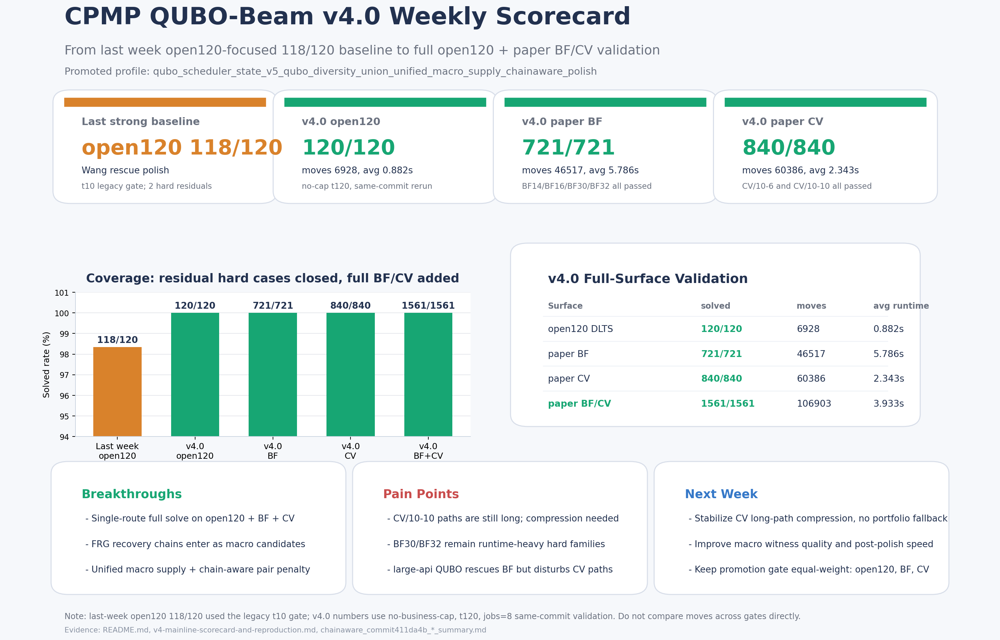

主题：CPMP QUBO-Beam v4.0 本周进展：三集合全量验收全解与下一步质量压缩

各位好，

本周主要围绕 CPMP QUBO-Beam v4.0 主线推进。相比上周仍以 open120 单面 118/120 的 Wang/QUBO 基线和局部 BF/CV 样本探索为主，本周完成了从“局部有效”到“open120、paper BF、paper CV 三集合共同验收”的主线升级。

配图如下：

一、工作内容

1. 推出并固化 v4.0 主推算法 profile：
   `qubo_scheduler_state_v5_qubo_diversity_union_unified_macro_supply_chainaware_polish`。
2. 将 BS-FRG 的深恢复链思想改造成可由 QUBO beam 选择的 macro candidate，而不是作为外部 fallback 或 portfolio。
3. 增加 unified macro supply，让更深层 parent 的恢复链候选也能进入候选池，弥补只看 top parent 容易错过恢复路径的问题。
4. 增加 chain-aware QUBO pair penalty，抑制 beam 被同一类 macro ancestry 占满，保持候选质量和多样性的平衡。
5. 修复 compact transition / compact lift 的脆弱点，并补齐 open120 与 paper BF/CV runner 的 full-surface 验证与文档。

二、主要突破

1. 解出率从上周 open120 118/120 的单面强基线，推进到 v4.0 三集合全量全解：
   - open120 DLTS：120/120，moves 6928，avg runtime 0.882s；
   - paper BF：721/721，moves 46517，avg runtime 5.786s；
   - paper CV：840/840，moves 60386，avg runtime 2.343s；
   - paper BF/CV full1561：1561/1561，moves 106903，avg runtime 3.933s。
2. 算法结构保持单搜索路径：QUBO 只做 beam survivor selection，FRG 只提供 replayable macro candidate，不引入最终 fallback solver。
3. 之前容易残留的 BF14、BF16、BF30、BF32，以及 CV/10-6、CV/10-10 等硬族，本周都纳入 full1561 全量验证并通过。
4. 文档侧完成 v4.0 算法说明、流程图、scorecard 与 reproduction command，后续可以用统一口径复现实验。

三、当前痛点

1. v4.0 已经优先解决了解出率，但部分 CV 大规模算例路径仍偏长，尤其 CV/10-10 和 CV/10-6 仍是下一阶段质量压缩重点。
2. BF30、BF32 等大规模 BF 硬族虽然已全解，但平均耗时仍高，后续还需要继续做候选生成、缓存和 post-polish 的工程加速。
3. large-api QUBO 分支在 BF 侧有救解价值，但全量实验显示会扰动 CV 路径质量，目前只能作为探索分支，不能直接升主线。
4. 后续调优必须继续坚持 open120、BF、CV 三集合同等重要，不能只看单点 hard case 或单集合局部提升。

四、下周计划

1. 优先做 CV 长路径稳定压缩，在不引入 portfolio fallback 的前提下，优化 macro witness quality、completion witness credit 和 post-polish window。
2. 针对 BF30/BF32 等高耗时族，继续做缓存、候选评分复用和局部 post-polish 加速，要求不牺牲当前全解率。
3. 对 large-api QUBO 分支做更严格 gate：只在明确低 slack / 高恢复压力场景参与，避免对普通 CV 搜索造成路径扰动。
4. 固化晋升标准：任何新 profile 都必须同时报告 open120、paper BF、paper CV 的 solved、moves、full penalty 和 runtime，且不得新增失败。

以上。
